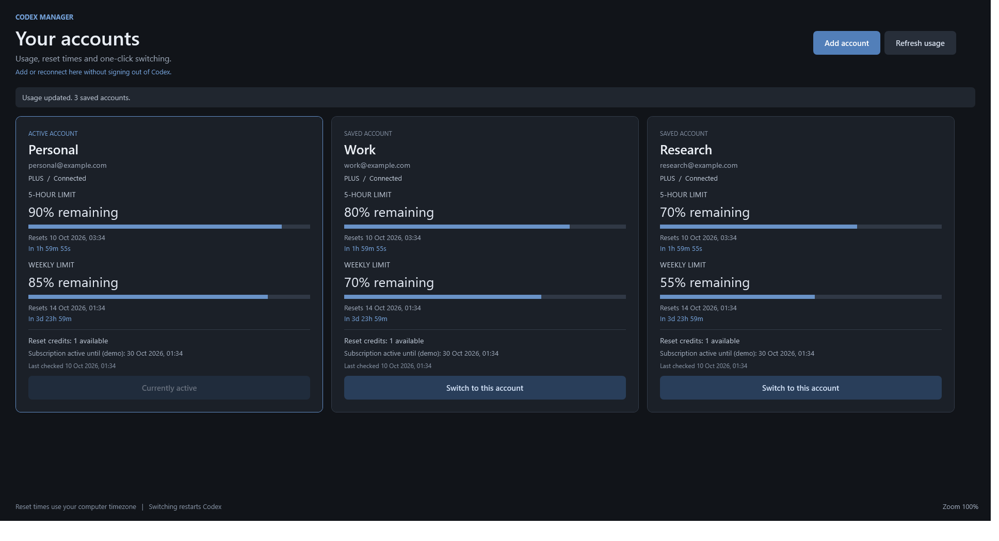

# Codex Manager — local Codex account switcher and usage dashboard for Windows

Codex Manager is an open-source Windows companion for the official Codex desktop app. Keep multiple Codex accounts on one computer, compare their available usage, and switch the desktop app to the account you choose.

**Beta · Unofficial · Windows only.** This project is not affiliated with or endorsed by OpenAI. Codex and OpenAI are trademarks of their respective owners.

[Download the latest release](https://github.com/DavitBadishyan/codex-manager/releases/latest) · [User guide](docs/USER_GUIDE.md) · [Security](SECURITY.md) · [Contributing](CONTRIBUTING.md)

*The screenshot uses fictional demo accounts and sample usage; it contains no real account data.*

## What it does

- Add accounts through browser sign-in without signing out of the existing desktop account.
- Import the current desktop login on first use when one is available.
- Refresh all saved accounts to compare remaining five-hour and weekly usage, reset dates and countdowns, and available credits.
- Show session status and available active-until dates. These dates are not a guaranteed next billing date.
- Switch the official desktop app with a restart, preserving the outgoing account's latest refresh tokens before replacing its login.
- Use a dark dashboard with zoom controls: **Ctrl + mouse wheel**, **Ctrl + +**, **Ctrl + −**, and **Ctrl + 0** to reset.

Account sessions can expire or be revoked. Reconnect an account when sign-in is required. Usage and credits depend on what OpenAI returns for that account; unavailable data is not a zero balance.

## Quick start

You need **Windows 10 or 11**, **Windows PowerShell 5.1**, and the official **OpenAI.Codex Microsoft Store desktop package** already installed. Codex Manager uses Windows Presentation Foundation (WPF). Linux and macOS are not supported.

1. Download the release ZIP from [Releases](https://github.com/DavitBadishyan/codex-manager/releases/latest).
2. Right-click the ZIP and choose **Extract All**. Open the extracted folder.
3. Double-click **Install.cmd**. The installer runs for your Windows user and does not require administrator access.
4. Open the **Codex Manager** shortcut.
5. Use **Add Account** to sign in to another account, then refresh and choose the account you want to switch to.

Finish or pause work in Codex before switching: the desktop app must restart. The manager requests a normal shutdown, then may force-close remaining Codex processes after 12 seconds. See the [step-by-step user guide](docs/USER_GUIDE.md) for sign-in, usage interpretation, and troubleshooting.

The release contains unsigned PowerShell scripts. Its launcher uses `ExecutionPolicy Bypass` for its bundled script process; it does not change your machine's permanent execution policy. Organization policies may still block it. On a managed computer, ask your administrator about approved use; do not disable managed controls.

## Local storage and privacy

Saved accounts, profiles, and runtime files live under `%LOCALAPPDATA%\CodexManager` on your computer. Codex Manager has no service of its own and no telemetry. It contacts OpenAI over HTTPS for authentication and usage, so it is **not an offline tool**.

**Authentication tokens are stored in plaintext files with restricted Windows permissions, not encrypted.** The intended access list permits your current Windows user, SYSTEM, and Administrators. Processes running as your user and administrators can still read them. Treat this folder as sensitive: do not upload it, share it, or include it in support reports. Read [SECURITY.md](SECURITY.md) before using saved accounts on a shared computer.

## Frequently asked questions

### Can I switch between multiple Codex accounts on Windows?

Yes. Add each account, refresh the dashboard, and switch the official desktop app to the selected saved account. Add Account uses an isolated browser login flow so the existing desktop account stays signed in while you connect another.

### Does this increase my Codex limits or bypass account restrictions?

No. It displays the limits returned for each signed-in account and lets you choose an account you are authorized to use. OpenAI's account, plan, and access rules still apply.

### Is the usage dashboard live?

Use Refresh to fetch updated usage for saved accounts. A countdown describes the reported reset time; it does not guarantee that limits or credits will stay unchanged until then. Expired sessions may need reconnection.

### Is this an official Codex app or a replacement for it?

No. It is a community companion that requires the official Windows desktop package. For the authentication and usage interface used by Codex, see OpenAI's [Codex App Server documentation](https://learn.chatgpt.com/docs/app-server).

### Does Codex Manager support Mac or Linux?

No. This release targets Windows 10/11 with Windows PowerShell 5.1 and WPF.

## Contribute

Bug reports, documentation improvements, and focused pull requests are welcome. Please read [CONTRIBUTING.md](CONTRIBUTING.md), use fictional test accounts and fixtures, and never commit tokens or account data. Release checks should cover installation, login isolation, refresh, switching, and token persistence; authenticated checks require your own authorized test accounts.

Licensed under the [MIT License](LICENSE).
